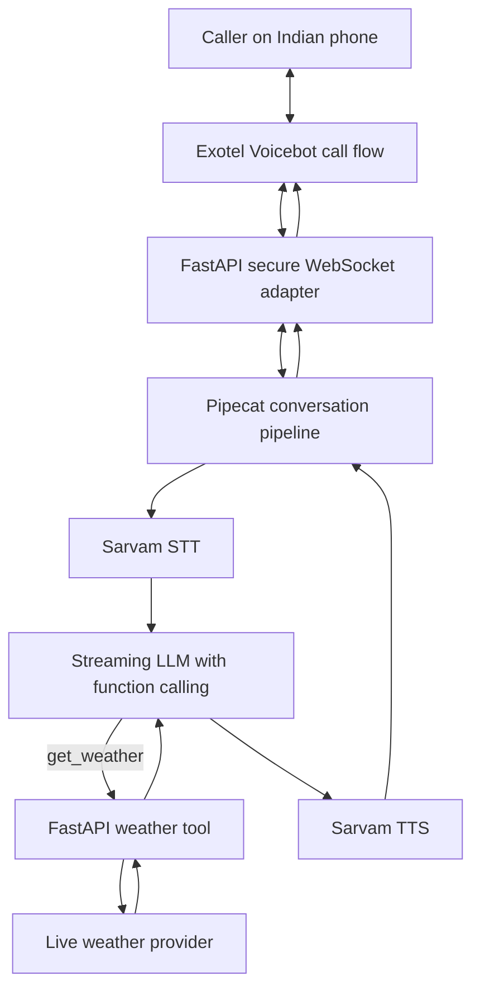

# Real-Time Weather Voice Agent — Implementation Specification

## Goal

Build a **code-first, low-latency telephone voice agent** using **Pipecat + Sarvam AI + Exotel + FastAPI**. The agent speaks with callers naturally, handles interruptions, and supports exactly **one tool: `get_weather`**.

The first milestone is a working inbound call. Outbound calls are a follow-up milestone and depend on Exotel account permissions and supported call routing.

## Technology choices

| Component | Role |
|---|---|
| Pipecat (Python) | Real-time audio pipeline, conversation orchestration, interruptions, LLM tool execution |
| Sarvam AI | Speech-to-text (STT) and text-to-speech (TTS) |
| Exotel | Indian PSTN calling and Voicebot call flow |
| FastAPI | Secure WebSocket/media endpoint and `get_weather` HTTP API |
| Streaming LLM | Conversation reasoning and function calling; select a Pipecat-supported tool-capable model |
| Weather data provider | Live weather information, e.g. Open-Meteo (geocoding + forecast endpoints) |

**Important:** These four named technologies do not by themselves provide an LLM or live weather data. The implementation must configure an LLM and a weather-data source. No Redis, PostgreSQL, frontend, or other tools are required for this proof of concept.

## End-to-end architecture



### Example interaction

1. Caller asks: **“What's the weather in Bengaluru today?”**
2. Exotel streams audio to the FastAPI WebSocket endpoint.
3. Pipecat routes audio to Sarvam STT and sends the transcript to the LLM.
4. LLM invokes `get_weather(city="Bengaluru")`.
5. FastAPI resolves the city and retrieves **live** conditions from the weather provider.
6. The tool returns concise structured weather data to the LLM.
7. The LLM responds naturally, e.g. “It's currently 27 degrees in Bengaluru…” **using actual returned values, not fabricated values**.
8. Sarvam TTS produces audio; Pipecat streams it back to Exotel.
9. If the caller interrupts, Pipecat stops obsolete speech and processes the new turn.

## Scope

**In scope**
- Real-time inbound call audio
- Hindi/English conversation (subject to selected Sarvam models)
- Natural interruptions / barge-in
- Exactly one tool: `get_weather`
- Real weather lookup by city
- Logs and stage-level latency measurements
- Local audio testing before telephony integration

**Out of scope for v1**
- Booking, payments, CRM, customer databases
- Multi-agent routing
- Web dashboard
- Redis, PostgreSQL, queues
- Bulk outbound calling campaigns

## Proposed project structure

```text
weather-voice-agent/
├── app/
│   ├── main.py                  # FastAPI app and health endpoint
│   ├── config.py                # Environment settings
│   ├── voice/
│   │   ├── pipeline.py          # Pipecat pipeline
│   │   ├── services.py          # Sarvam STT/TTS and streaming LLM
│   │   └── prompts.py           # Voice agent instructions
│   ├── telephony/
│   │   └── exotel.py            # Exotel WebSocket audio adapter
│   ├── tools/
│   │   └── weather.py           # get_weather tool + provider client
│   └── api/
│       └── routes.py            # /health and /tools/get-weather
├── tests/
│   ├── test_weather.py
│   └── test_audio.py
├── .env.example
├── pyproject.toml
├── Dockerfile
└── README.md
```

## Environment variables

```dotenv
SARVAM_API_KEY=
LLM_API_KEY=
LLM_MODEL=

# Public endpoint used by Exotel once deployed
PUBLIC_WSS_URL=wss://your-domain.example/ws/exotel

# Only if required by the selected Exotel integration/API
EXOTEL_ACCOUNT_SID=
EXOTEL_API_KEY=
EXOTEL_API_TOKEN=

WEATHER_REQUEST_TIMEOUT_SECONDS=4
LOG_LEVEL=INFO
```

Do not commit real secrets. Weather provider credentials are optional if using a public API such as Open-Meteo within its terms.

## The single tool: `get_weather`

### Function schema for the LLM

```json
{
  "name": "get_weather",
  "description": "Get current weather for a city using live weather data.",
  "parameters": {
    "type": "object",
    "properties": {
      "city": {
        "type": "string",
        "description": "City name, such as Bengaluru or Mumbai"
      }
    },
    "required": ["city"]
  }
}
```

### FastAPI endpoint

`POST /tools/get-weather`

Request:

```json
{"city": "Bengaluru"}
```

Successful response shape:

```json
{
  "city": "Bengaluru",
  "temperature_c": 27.0,
  "relative_humidity_percent": 65,
  "wind_speed_kmh": 8.0,
  "condition": "Partly cloudy",
  "observed_at": "2026-10-11T08:30:00+05:30",
  "source": "weather_provider"
}
```

**The values above are illustrative schema examples, not live weather observations.**

### Tool implementation behavior

1. Validate and normalize `city` (non-empty, reasonable length).
2. Geocode the city to latitude/longitude using a weather provider's geocoding endpoint.
3. If multiple cities match, prefer an explicit country/state supplied by the caller or ask for clarification rather than guessing.
4. Request current weather for the coordinates with a bounded timeout.
5. Normalize units and return a small JSON object.
6. If the city cannot be resolved or the provider times out, return a typed error; the agent should explain it briefly and ask the caller to try again.
7. Do not hallucinate temperatures or forecasts.

For Open-Meteo, verify current API parameters and attribution/usage terms at https://open-meteo.com/en/docs and https://open-meteo.com/en/docs/geocoding-api .

### FastAPI/Pydantic interface example

```python
from fastapi import APIRouter
from pydantic import BaseModel, Field

router = APIRouter()

class WeatherRequest(BaseModel):
    city: str = Field(min_length=1, max_length=120)

@router.post("/tools/get-weather")
async def get_weather_endpoint(payload: WeatherRequest):
    # Implement provider geocoding + live current-weather request.
    # Return structured data; do not hardcode sample weather values.
    return await fetch_live_weather(payload.city)
```

`fetch_live_weather` is an application function to implement; this snippet is an **interface sketch**, not a complete runnable server.

## Voice-agent behavior

- Start with a short greeting: “Hi! I can check the weather for any city. Which city?”
- Understand English, Hindi, and natural Hinglish when the selected models support them.
- Ask for the city if it is missing.
- Invoke `get_weather` for factual weather questions.
- State temperature in Celsius by default.
- Answer concisely (1–2 spoken sentences), then allow follow-up questions.
- If data is unavailable, say so and request another city or retry.
- Never claim to have checked live weather unless the tool returned successfully.
- Avoid reading raw JSON, URLs, or implementation details aloud.

## Pipecat pipeline requirements

```text
Exotel incoming audio
  → Exotel protocol/frame adapter
  → decode/resample to expected audio format
  → Pipecat transport + turn detection
  → Sarvam streaming STT (if supported by selected integration)
  → streaming tool-capable LLM
      ↳ get_weather → FastAPI → live weather provider
  → Sarvam TTS
  → encode/frame audio for Exotel
  → Exotel outgoing audio
```

Implement one isolated pipeline task per active call. Ensure disconnect cleanup, error handling, and cancellation of queued speech when the user interrupts. Verify Pipecat version-specific classes and Sarvam integration support before writing production code.

## Exotel integration steps

1. Keep the existing Exotel account and Voicebot flow available.
2. Develop the FastAPI/Pipecat server locally; test with microphone/speaker or simulated audio first.
3. Implement the exact WebSocket handshake, audio messages, codecs, and event handling required by Exotel Voicebot. A generic WebSocket endpoint alone is not enough.
4. Deploy the server with a public **WSS** URL.
5. Update the Exotel Voicebot applet's bot connection URL to the **custom Pipecat endpoint** when ready. The earlier Sarvam-managed URL is for the managed Sarvam agent, not automatically for the custom Pipecat server.
6. Save the Exotel call flow and ensure the phone number routes to it.
7. Test an inbound call and confirm both directions of audio, weather tool invocation, interruption handling, and hangup cleanup.
8. Only after inbound succeeds, investigate outbound calling using Exotel's supported API and account permissions.

Existing Sarvam dashboard connectivity does **not** imply the custom Pipecat agent is deployed or connected.

## Latency optimization checklist

- Stream STT/LLM/TTS where supported instead of waiting for complete outputs.
- Keep the weather API call asynchronous with a strict timeout.
- Reuse HTTP connections for weather provider requests.
- Keep agent instructions and tool schemas short.
- Avoid multiple sequential tool calls for a single weather question.
- Tune VAD/end-of-turn settings to avoid long pauses or cutting users off.
- Support interruption and cancellation of stale TTS audio.
- Host the voice server in a region with good connectivity to Exotel and the selected AI providers.
- Measure **end of caller speech → first audible agent response** at p50/p95, plus weather tool duration.
- Never assume a fixed latency number without real phone-call benchmarks.

## Development milestones

### Phase 1 — Local voice agent
- [ ] Initialize Python project with `uv`.
- [ ] Install version-compatible Pipecat, Sarvam, and LLM integrations.
- [ ] Configure Sarvam STT and TTS.
- [ ] Configure streaming LLM.
- [ ] Test a natural spoken conversation locally.

### Phase 2 — Weather tool
- [ ] Build FastAPI app and `/health`.
- [ ] Implement city geocoding and live weather lookup.
- [ ] Expose `POST /tools/get-weather`.
- [ ] Register `get_weather` as an LLM function in Pipecat.
- [ ] Verify voice question → tool call → spoken weather response.

### Phase 3 — Phone integration
- [ ] Build Exotel-compatible WebSocket audio adapter.
- [ ] Deploy FastAPI/Pipecat to a public HTTPS/WSS host.
- [ ] Point Exotel Voicebot applet to the deployed endpoint.
- [ ] Route the Exotel phone number to the correct flow.
- [ ] Test inbound +91 phone conversation.

### Phase 4 — Performance and reliability
- [ ] Add timing logs for STT, LLM, tool, TTS, and end-to-end response.
- [ ] Test interruption, silence, disconnection, and weather API failures.
- [ ] Benchmark repeated calls and tune the pipeline.
- [ ] Confirm outbound permissions before adding outbound calls.

## Acceptance tests

1. **“What's the weather in Mumbai?”** → calls `get_weather("Mumbai")` and reads returned live data.
2. **“दिल्ली में मौसम कैसा है?”** → identifies Delhi and replies in an appropriate supported language.
3. **“What's the weather?”** → asks which city.
4. **Unknown city** → asks for clarification instead of inventing data.
5. **Provider unavailable** → brief apology and retry suggestion.
6. **Caller interrupts** → stops old audio and handles the new request.
7. **Call hangs up** → cleans up session and connections.

## References

- Pipecat: https://docs.pipecat.ai/
- Sarvam: https://docs.sarvam.ai/
- Sarvam + Exotel integration guide: https://docs.sarvam.ai/api/integration/build-voice-agent-with-exotel
- Exotel developer docs: https://developer.exotel.com/
- FastAPI: https://fastapi.tiangolo.com/
- Open-Meteo: https://open-meteo.com/en/docs

**Implementation priority:** Local Pipecat conversation → live `get_weather` tool → Exotel inbound phone integration → latency benchmarking → outbound feasibility.
